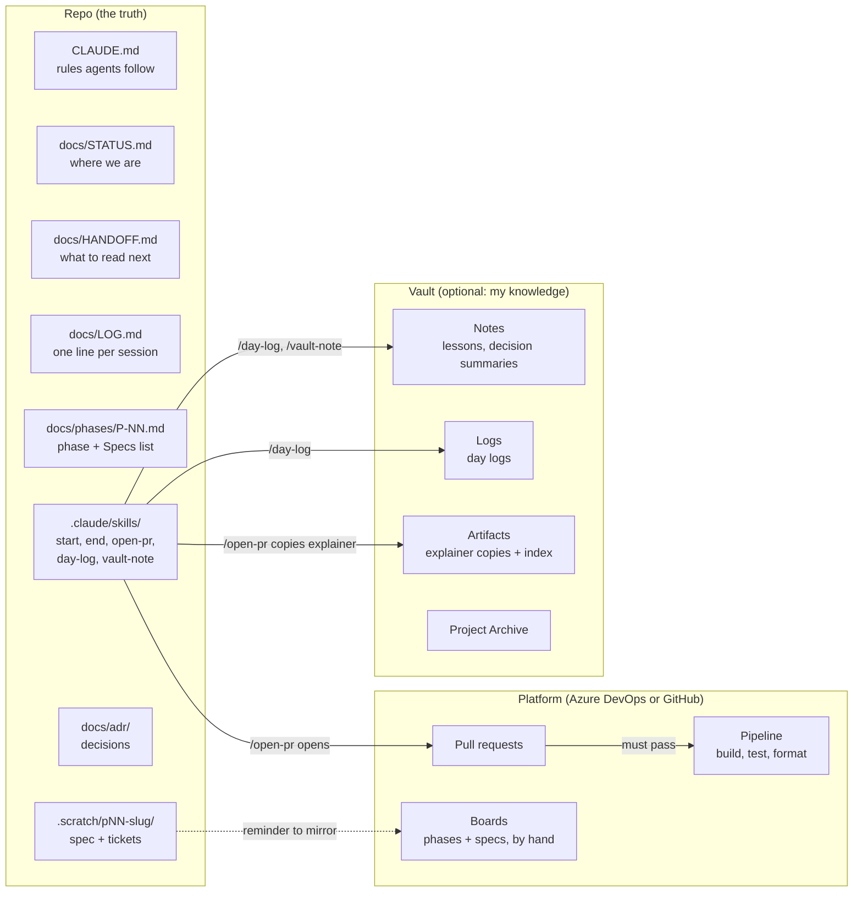
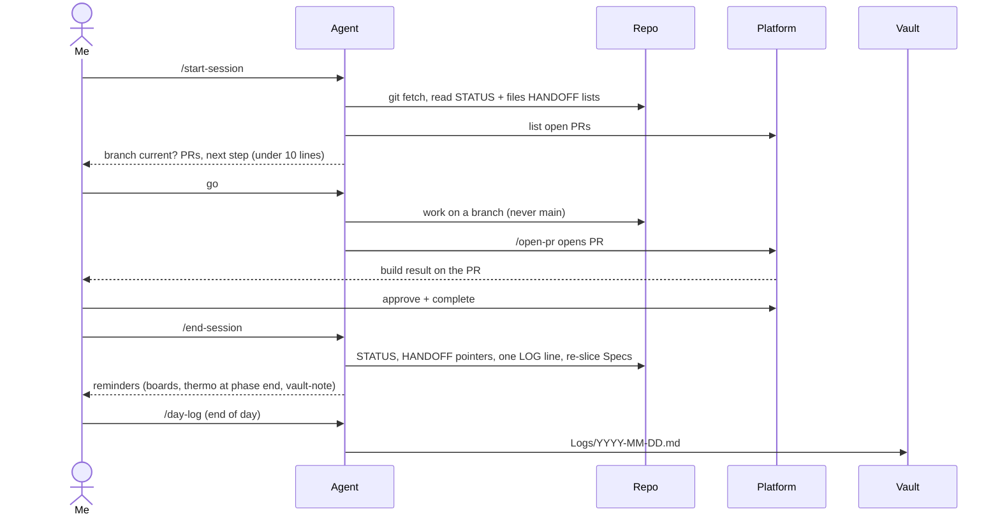
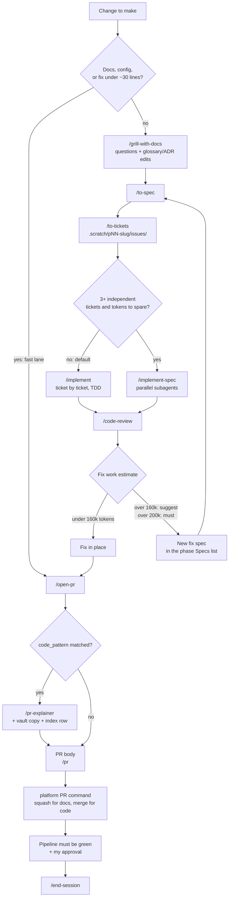
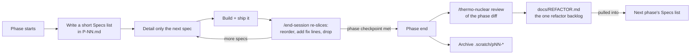
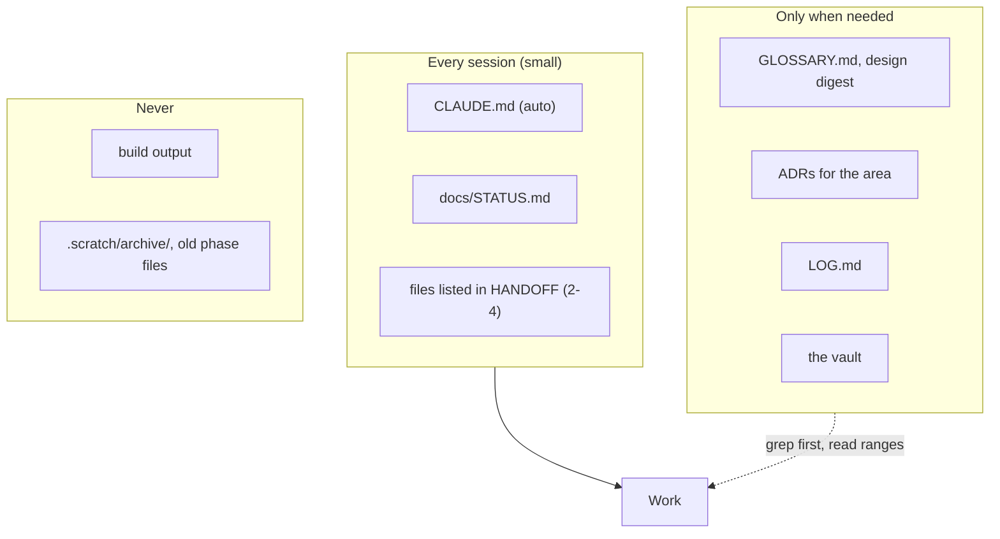

# Workflow Guide

How work flows from an idea to `main`, which skill does what, where every file lives, and how agents keep their context small. First written for the PoReader project (2026-11-20, preset `full`, platform `azure`); kept here as the starting point. A project's `CLAUDE.md` is what agents follow; this is the human map of it.

> **The short version.** **Start** with `/start-session`. **Think** with `/grill-with-docs`. **Plan** with `/to-spec` and `/to-tickets`. **Build** with `/implement`. **Check** with `/code-review`. **Ship** with `/open-pr`. **Close** with `/end-session`. At the end of the day, `/day-log`.

---

## 1. The map: where everything lives

| Where | What lives there | Who writes it |
|---|---|---|
| Repo | Rules, state, plans, specs, tickets, decisions, code | Agents (I review the diff) |
| Platform | PRs, builds, board items | `/open-pr` opens PRs; I approve and complete; boards by hand |
| Vault, agent folder | Lessons, decision summaries, day logs, explainer copies, archive | Agents, only in that folder |
| Vault, my notes | My own notes, hours and status | Me |

---

## 2. A session from start to finish

---

## 3. The coding chain

**One PR per spec**, tickets as commits; split if the diff passes about 400 lines.

**Size check.** After review the agent prints a rough estimate: lines it must read or change x about 12 tokens, plus about 20k. Over 160k it suggests a fix spec; over 200k it must.

**Why `/implement` is the default.** `implement-spec` runs several agents at once, and each re-reads the spec and code, so it uses more tokens in total and burns them faster. Use it when time matters more than the usage limit.

---

## 4. Phases are sliced as we go

- **Why not slice everything up front?** Specs written early go stale as earlier work teaches us things. Only the next spec gets detail.
- **Specs list states:** `next`, `planned`, `done`, `dropped`, plus `fix:` lines.
- **Fixes by size:** tiny -> fast lane; medium -> a `fix:` spec in the current list; belongs later -> a line in that phase's list.
- **Refactoring:** found by the phase-end thermo review, kept in `docs/REFACTOR.md`, scheduled into the next phase.

---

## 5. Context: what an agent reads

- Session start is about 3-4k tokens: no duplicated state (STATUS holds state, HANDOFF only points).
- Wide searches and reviews go to subagents; only their conclusions come back.
- Agents remember a few working habits in their memory (archive don't delete, UTF-8 edits, ASCII PR text on Azure, check git before claiming); project facts stay in the repo.

---

## 6. Skills at a glance

| Skill | When | What it writes |
|---|---|---|
| `/start-session` | Start of a session | Nothing; reports branch, PRs, next step |
| `/grill-with-docs` | Before a non-trivial spec | `GLOSSARY.md`, ADRs (with the PR) |
| `/to-spec`, `/to-tickets` | Planning a spec | `.scratch/pNN-slug/` |
| `/implement` / `implement-spec` | Building | Code, tests, commits |
| `/code-review` | Before every code PR | Review findings + size estimate |
| `/open-pr` | Opening any PR | PR body, explainer (code only), PR |
| `/pr-explainer` | Called by `/open-pr`, or on request | explainer HTML + vault copy + index row |
| `/end-session` | End of a session | STATUS, HANDOFF, one LOG line, Specs list |
| `/thermo-nuclear-code-quality-review` | End of a phase | Findings in `docs/REFACTOR.md` |
| `/day-log` | End of the day | `Logs/YYYY-MM-DD.md` |
| `/vault-note` | Something worth keeping | A lesson or decision summary |
| `/wayfinder` | Only for a very foggy phase | A decision map in `.scratch/` |

**How `/grill-with-docs` works:** it runs `grilling` (questions in rounds, each with a recommended answer, facts looked up by subagents, nothing done until we agree) together with `domain-modeling` (checks my words against `GLOSSARY.md`, updates it as terms settle, offers an ADR only if a decision is hard to reverse, surprising, and a real trade-off).

---

## 7. Tips
- If STATUS and git disagree, trust git and the platform; `/start-session` says so.
- Open PRs only with `/open-pr`; it checks the branch is pushed and picks squash or merge.
- On Azure, PR text must be plain ASCII; the CLI drops other characters.
- Archive, never delete: repo `.scratch/archive/`, `docs/archive/`; vault `Project Archive`.
- Keep vault paths short (under ~200 characters); OneDrive and Windows choke on long ones.
- Learning is opt-in: ask "explain this" any time.
